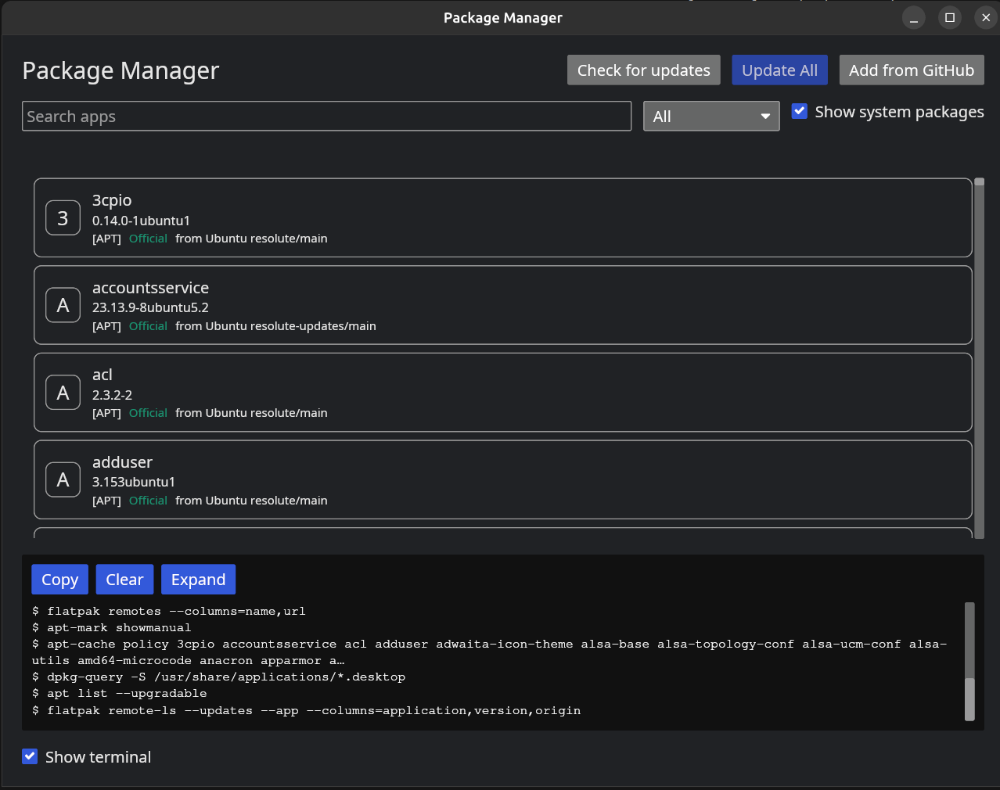
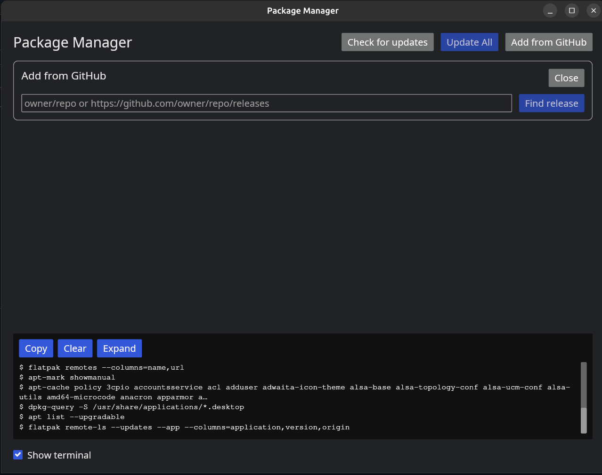

# Package Manager

**One window to see and install updates for everything you installed on Ubuntu or Debian:
system packages, Flatpak apps, and apps you downloaded from GitHub as `.deb` files.**

Most updaters only see the first two. If you installed Hydra Launcher, rclone or a similar app
from its GitHub releases, nothing tells you when a new version is out. Package Manager does:
you link the app to its repository once, and from then on its updates appear in the same list.



> **Status: 1.0, alpha quality.** It is in use on the author's Ubuntu machine and has automated
> tests, but it has not been tried on a clean install or on Debian yet, and the privileged helper
> has had no independent security review. Read [Security](#security) before using it.

## Features

- **One list for three sources:** APT system packages, Flatpak apps and GitHub-linked apps.
  Each row has a source badge (`[APT]`, `[Flatpak]`, `[GitHub]`, `[Manual .deb]`) and a
  trust label: **Official**, **Verified**, **Community** or **Unknown**.
- **Shows where an app comes from:** the source, the repository or archive, and the release
  page, so you can check it yourself. Nothing is guessed: an app with no proof of origin is
  labelled **Unknown**.
- **Add from GitHub:** paste `owner/repo` or any `github.com/.../releases` link. Package Manager
  finds the `.deb` for your CPU, shows the tag, file name, size and checksum status, and then
  installs it or only links it, so future updates come from that repository.

  

- **Checksums:** the maintainer's checksum (`.sha256`, `SHA256SUMS`, `checksums.txt` or
  electron-builder's `latest-linux.yml`) is verified before anything is installed. If a release
  publishes no checksum, you must confirm that explicitly.
- **Terminal panel:** a read-only log of every command the app runs, with its output.
- **Update-only:** it does not browse a store or install new apps you did not ask for.

## Supported systems

Ubuntu, Debian and their derivatives (Linux Mint, Pop!_OS, elementary OS, Zorin and similar):
any system that uses APT and `.deb` packages. Flatpak is optional; if it is missing, that source
is skipped.

Not supported: Fedora and other RPM systems, Arch, Snap and AppImage.

Tested so far on Ubuntu 26.04 only.

## Install

Download `package-manager_1.0.0_amd64.deb` from the [latest release](https://github.com/fabox-os/package-manager/releases/latest),
then install it:

```bash
sudo apt install ./package-manager_1.0.0_amd64.deb
```

Start **Package Manager** from your app menu, or run `package-manager` in a terminal.

To remove it:

```bash
sudo apt remove package-manager
```

Your settings and the list of linked apps stay in `~/.config/package-manager`. Delete that folder
too if you want a complete removal.

## How it works

- The window runs as your user. It never runs as root.
- Installing goes through a small helper, started with `pkexec`, that asks for your administrator
  password **every time**. The authorization is never cached.
- The helper accepts only what it expects: a valid package name, a real `.deb` file inside your
  own download folder, the checksum you approved, and a package whose name inside the file
  matches the one you linked.
- Downloads come only from `https://github.com/<owner>/<repo>/releases/download/...`, from the
  repository you linked. Files from any other repository are ignored.

## Security

- **A `.deb` runs scripts as root.** Linking a repository means trusting its owner. A checksum
  published next to the file proves it arrived intact, not who made it.
- **Signatures are not checked.** OpenPGP and sigstore verification are not implemented, so you
  are trusting the release page of the repository you linked.
- **Alpha.** The helper runs as root and has not had an independent review. Please review the code
  before you rely on it on a machine that matters to you.
- No telemetry and no phone-home. The only network traffic is to GitHub (release data and
  downloads) and your normal APT and Flatpak sources.

Please report vulnerabilities privately to the maintainer, not in a public issue.

The design and threat model are described in [ARCHITECTURE.md](ARCHITECTURE.md).

## Build from source

You need Rust 1.80 or newer.

```bash
cargo build --release
./packaging/build-deb.sh        # writes dist/package-manager_<version>_<arch>.deb
```

For development, run the window straight from the build tree (debug builds find the helper next to
the executable, so nothing has to be installed):

```bash
cargo run -p package-manager-app
cargo test --workspace
cargo clippy --workspace -- -D warnings
```

[AGENTS.md](AGENTS.md) describes the code layout and conventions, and [ROADMAP.md](ROADMAP.md)
lists what is done and what is planned.

## Contributing

Issues and pull requests are welcome. Please keep changes small and tested, and read
[AGENTS.md](AGENTS.md) first: it sets the rules for the privileged helper and the GitHub code,
which need two reviewers.

## License

Package Manager is free software: you can redistribute it and/or modify it under the terms of the
GNU General Public License as published by the Free Software Foundation, either version 3 of the
License, or (at your option) any later version. It is distributed in the hope that it will be
useful, but WITHOUT ANY WARRANTY. See [LICENSE](LICENSE).

Copyright (C) 2026 Package Manager contributors
